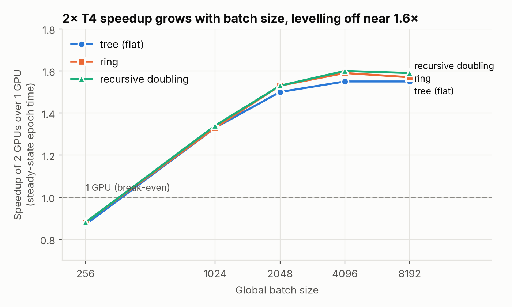
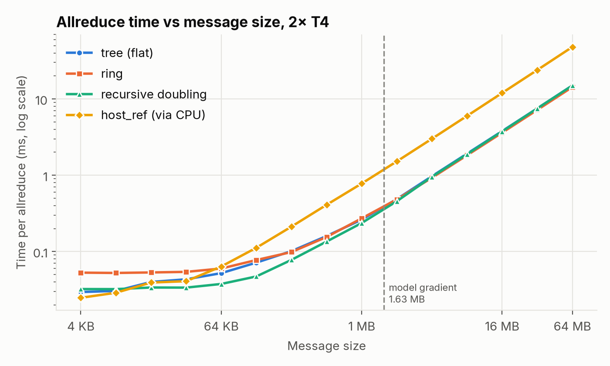
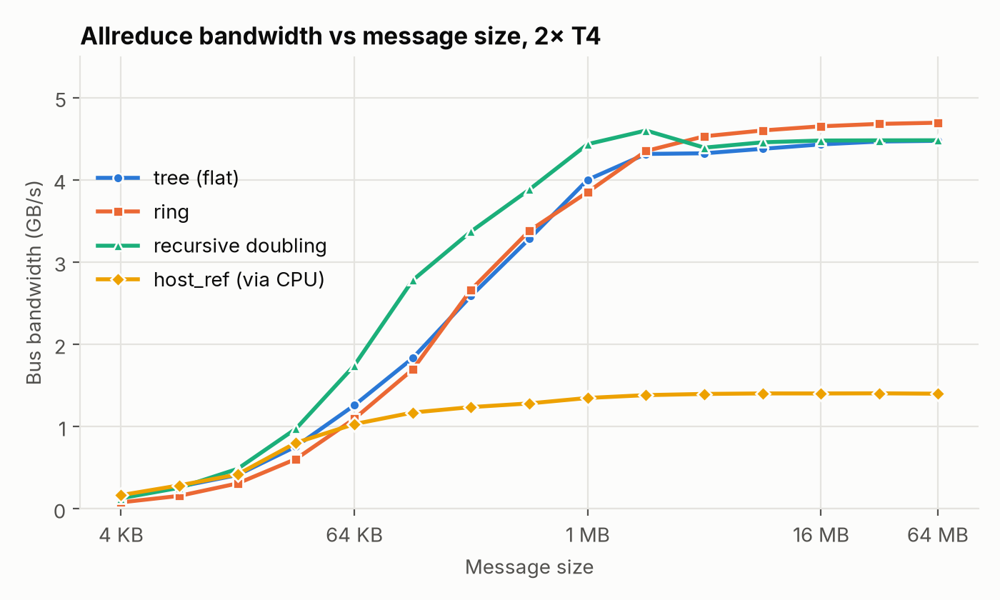

# Data-parallel SGD on CUDA with hand-written allreduce: results

_Tiếng Việt: [README.md](README.md)_

Topic 10 (Multi-GPU Communication Optimization), based on Hegde & Usmani, *Parallel and
Distributed Deep Learning* (Stanford). An MLP is trained on MNIST with synchronous data-parallel
SGD on k GPUs, and the gradients are averaged with hand-written allreduce methods (no NCCL,
cuBLAS or MPI). The paper analyses the communication cost (O(L·k) + O(k·p/B)) only in theory;
this project measures it.

Sections 1–6 come from Kaggle, 2× Tesla T4, with the fixed settings (10 epochs) and 3 repeats per
configuration, built from this part's own repository, [infinityrbx/HPC_20261B_GroupN_DataParallelSGD_CUDA](https://github.com/infinityrbx/HPC_20261B_GroupN_DataParallelSGD_CUDA) (commit [3fd2b8a](https://github.com/infinityrbx/HPC_20261B_GroupN_DataParallelSGD_CUDA/commit/3fd2b8a)); the code in this folder is the same as that repository's. Results and raw CSVs:
[`runs/kaggle-final-2026-11-22/`](runs/kaggle-final-2026-11-22/) (training and allreduce, with
[`summary.md`](runs/kaggle-final-2026-11-22/summary.md)) and
[`runs/kaggle-profile-2026-11-22/`](runs/kaggle-profile-2026-11-22/) (kernel profile) and
[`runs/kaggle-sweep-2026-11-23/`](runs/kaggle-sweep-2026-11-23/) (batch-size sweep). An earlier
2-epoch run is kept in [`runs/kaggle-2026-11-22/`](runs/kaggle-2026-11-22/).

Section 7 (scaling to 4 GPUs, NVLink vs PCIe) comes from one RunPod machine with 4× A100-SXM4-80GB,
5 epochs and 3 repeats per configuration:
[`runs/runpod-a100-2026-11-23/`](runs/runpod-a100-2026-11-23/).

Full report (PDF, Vietnamese): [`docs/report/bao-cao.pdf`](docs/report/bao-cao.pdf).

## Summary

| Question | Answer |
|---|---|
| Are the GPU allreduce methods correct? | Yes. tree, ring and rd pass every check; replicas stay bitwise identical; over 10 epochs the loss stays within 2.3e-5 of 1-GPU training; test accuracy 96.14 % (1 GPU and CPU: 96.16 %). |
| Is a GPU faster than a CPU for training? | Yes. 1 T4: 0.199 s per epoch; sequential C on one CPU core: 8.19 s. About **41×**. |
| Is matrix multiplication the bottleneck? | Yes. 99.7 % of the FLOPs and **94.5–95.5 % of GPU kernel time** (nsys). |
| How much does communication cost? | About **half of every 2-GPU step** (50–51 % exposed communication) with tree, ring and rd; 75 % through the CPU. One allreduce of the 1.63 MB gradient takes about 0.36–0.39 ms on the GPUs, 1.19 ms through the CPU (interpolated between the 1 MB and 2 MB points). |
| Do 2 GPUs beat 1? | It depends on the batch size. At the default batch of 256, no: 0.87–0.89×, because communication costs about as much as the compute saved by splitting the batch. From a batch of 1024 up, yes: 1.33× at 1024, 1.53× at 2048 and up to **1.60×** at 4096 (section 6). |
| Which allreduce wins? | In the raw benchmark: host_ref at 4–8 KB, recursive doubling from 16 KB to 2 MB, ring from 4 MB up. In training, tree, ring and rd are within 2 % of each other and their repeat ranges overlap, so none wins. |
| Does NVLink fix it, and what about 4 GPUs? | Partly (section 7, 4× A100 SXM). NVLink moves large messages 12–27× faster than going through the host (ring: 157 GB/s against 5.8 GB/s at k=4). At batch 4096, 4 GPUs give up to **1.59×** with NVLink but only 1.23–1.33× through the host. At batch 256 more GPUs are slower even with NVLink, because the small gradient makes each allreduce latency-bound. |

## Figures

Drawn from the CSVs in `runs/` by `python3 scripts/make_figures.py`.

| | |
|---|---|
|  |  |
|  |  |
|  |  |


## Setup

| Item | Value |
|---|---|
| Hardware | Kaggle, 2× Tesla T4 (70 W, sm_75), driver 580.178, CUDA 13.0 |
| Interconnect | PCIe through the host bridge (topology PHB) |
| Model | MLP 784–512–10, 407,050 parameters (gradient 1.63 MB fp32) |
| Training | seed 42, global batch 256 (128 per GPU at k = 2), lr 0.1, 10 epochs, 3 repeats per configuration (median reported) |
| Benchmark | 4 KB to 64 MB, 5 warm-up + 20 timed runs, median; busbw = bytes/time × 2(k−1)/k |

Methods (one file each in `src/allreduce/`):

| Method | How it works |
|---|---|
| `host_ref` | Copy every gradient to the CPU, average, copy back. Reference for correctness |
| `tree` | Reduce to GPU 0 (the driver, as in §5 of the paper), average, broadcast. Flat tree: GPU 0 talks to each GPU in turn, cost 2(k−1)(α + nβ), which equals the paper's summed message cost O(L·k) + O(k·p/B); the paper uses a BitTorrent aggregate (binomial tree, log₂k parallel rounds) |
| `ring` | Reduce-scatter, then allgather (no chunk pipelining) |
| `rd` | Recursive doubling; extra GPUs are folded in when k is not a power of two |
| `--overlap` | Start the allreduce of layer 2 while layer 1's backward is still running |

## 1. Correctness

| Check | host_ref | tree | ring | rd |
|---|---|---|---|---|
| `make simcheck` (mocked CUDA, random stream orders, k = 2..8; 5,670 runs) | n/a | pass | pass | pass |
| `bench_allreduce --check-only`, all sizes incl. odd n | pass | pass | pass | pass |
| Max parameter difference between replicas | 0 (bitwise) | 0 (bitwise) | 0 (bitwise) | 0 (bitwise) |
| Loss vs 1 GPU over 10 epochs, max abs diff | 2.3e-5 | 2.3e-5 | 2.3e-5 | 2.3e-5 |
| Test accuracy, 10 epochs | 96.14 % | 96.14 % | 96.14 % | 96.14 % |

1 GPU and the sequential C version both reach 96.16 % (max loss diff 1e-5). The 0.02-point gap
on 2 GPUs comes from summing the gradient in a different order, which changes float rounding.

## 2. GPU vs CPU

| Version | Epoch time (steady state) | Speedup |
|---|---|---|
| Sequential C, one CPU core (`mlp_seq`) | 8.19 s | 1× |
| 1× T4 (`train_dp --gpus 1`), median of 3 runs | 0.199 s | ~41× |

Both reach the same loss curve and 96.16 % test accuracy.

## 3. Matrix multiplication is the compute bottleneck

The model is an MLP, but a fully connected layer is one matmul and a convolution becomes one
matmul after im2col, so the same argument covers CNNs.

**FLOP count** (`scripts/flops.py`, H = 512, batch 256): the five matmuls per step are
418.9 MFLOP; everything else (bias + ReLU, softmax, ReLU backward, bias gradients, SGD update)
is 1.4 MFLOP. Matmul is **99.7 % of the FLOPs**, at every hidden size. For comparison, one
3×3 conv layer with 32→64 channels on a 28×28 image is a (784×288)·(288×64) matmul,
28.9 MFLOP per image.

**Measured time** (nsys, one epoch on 1 T4, [`kernel_share.csv`](runs/kaggle-profile-2026-11-22/kernel_share.csv)):

| Kernel | H = 512 | H = 1024 | H = 2048 |
|---|---|---|---|
| `k_matmul_tiled` | **94.5 %** | **95.0 %** | **95.5 %** |
| `k_sgd` | 1.6 % | 2.4 % | 2.5 % |
| `k_colsum` | 1.8 % | 0.9 % | 0.5 % |
| `k_bias_relu` | 0.9 % | 0.8 % | 0.8 % |
| `k_softmax_xent` | 0.8 % | 0.5 % | 0.2 % |
| `k_relu_backward` | 0.4 % | 0.4 % | 0.5 % |
| Total kernel time | 220.7 ms | 368.1 ms | 715.2 ms |

The time share is a little below the FLOP share because the element-wise kernels are
memory-bound: they do almost no arithmetic but still read and write every element. The tiled
matmul does about 106 GFLOP per epoch (training plus test-set forward passes) in 208.5 ms of kernel
time, about 510 GFLOP/s or 6 % of the T4's FP32 peak, so a faster matmul would cut every step's
compute directly.

## 4. Communication cost and speedup on 2 GPUs

`train_dp` reports the epoch time and the exposed communication (end of backward to end of
allreduce on GPU 0) as a share of the step. Median of 3 runs, min–max in brackets; steady state =
median of epochs 2–10 (epoch 1 includes warm-up):

| Config | Steady epoch (s) | Speedup vs 1 GPU | Exposed comm |
|---|---|---|---|
| 1 GPU | 0.199 (0.199–0.200) | 1.00× | 0.5 % |
| host_ref | 0.420 (0.420–0.420) | 0.47× | 74.9 % |
| host_ref + overlap | 0.433 (0.431–0.436) | 0.46× | 71.6 % |
| tree | 0.225 (0.225–0.227) | 0.88× | 50.9 % |
| tree + overlap | 0.227 (0.226–0.227) | 0.88× | 50.4 % |
| ring | 0.225 (0.223–0.225) | 0.88× | 49.8 % |
| ring + overlap | 0.227 (0.226–0.228) | 0.88× | 50.9 % |
| rd | 0.228 (0.224–0.229) | 0.87× | 50.1 % |
| rd + overlap | 0.224 (0.224–0.225) | 0.89× | 49.7 % |

What this shows:

- About half of every 2-GPU step is communication. In the benchmark (section 5), one allreduce
  of the model's 1.63 MB gradient takes about 0.36–0.39 ms on the GPUs (interpolated between 1 MB and 2 MB), so communication costs about as
  much as the compute saved by splitting the batch, and 2 GPUs end up about 12 % slower than 1.
- Doing the reduction on the GPUs instead of the CPU halves the epoch time (0.420 s → 0.225 s)
  and lowers exposed communication from 75 % to about 50 %. A CPU allreduce of 1.63 MB takes
  1.19 ms, three times the GPU methods.
- tree, ring and rd are within 2 % of each other in training, and their ranges over 3 repeats
  overlap, so the measurements cannot rank them at this message size.
- For tree, ring and rd, `--overlap` makes no measurable difference (within ±1 %); a two-layer MLP
  has little backward work left to hide communication behind. For host_ref, `--overlap` is about 3 %
  slower (0.433 against 0.420 s, ranges do not overlap).
- Repeats are tight: the 3 runs of each configuration differ by at most 2 %.

## 5. Raw allreduce: which method wins at which size

Median time per allreduce, k = 2, ms ([`allreduce.csv`](runs/kaggle-final-2026-11-22/allreduce.csv)); bold is fastest:

| Size | host_ref | tree | ring | rd |
|---|---|---|---|---|
| 4 KB | **0.025** | 0.029 | 0.053 | 0.032 |
| 8 KB | **0.029** | 0.030 | 0.052 | 0.032 |
| 16 KB | 0.039 | 0.040 | 0.053 | **0.034** |
| 64 KB | 0.064 | 0.052 | 0.060 | **0.038** |
| 256 KB | 0.212 | 0.101 | 0.098 | **0.078** |
| 1 MB | 0.779 | 0.262 | 0.272 | **0.237** |
| 2 MB | 1.518 | 0.486 | 0.482 | **0.456** |
| 4 MB | 3.005 | 0.970 | **0.926** | 0.955 |
| 16 MB | 11.970 | 3.787 | **3.608** | 3.747 |
| 64 MB | 47.980 | 15.001 | **14.298** | 14.979 |

Bus bandwidth at 64 MB: host_ref 1.40, tree 4.47, ring 4.69, rd 4.48 GB/s.

- **Small messages are latency-bound.** For 4–8 KB, two small copies through the CPU are slightly
  faster than any GPU method. Ring has a floor of about 0.053 ms because it runs more dependent
  steps; tree and rd start at about 0.029–0.032 ms.
- **Medium messages (16 KB–2 MB) favour recursive doubling**, by up to 34 % at 128 KB (28 % at 64 KB) and 5–10 % at
  1–2 MB. The model's 1.63 MB gradient is in this range.
- **Large messages are bandwidth-bound and favour ring**, but only by 4–5 %. The CPU path is
  3.3× slower than the GPU methods here (1.4 vs 4.5–4.7 GB/s).
- **All three GPU methods level off at the same 4.5–4.7 GB/s**, so the limit is the link (PCIe
  through the host bridge), not the algorithm. Ring and rd could use both directions at once but do
  not get past tree, which suggests the two directions do not overlap and ring would need chunk
  pipelining.
- **Reproducible.** These numbers match the earlier 2-epoch run on another Kaggle machine within
  0.3 % for messages of 4 MB and up, and within 9 % for small messages.
- With k = 2, the three GPU algorithms move the same amount of data. Their textbook differences
  only show at k ≥ 4.

## 6. When do 2 GPUs pay off? Batch-size sweep

The gradient is always 1.63 MB, so communication per step is fixed (about 0.4 ms), while the
compute per step grows with the batch. A larger global batch therefore shrinks the share of time
spent communicating. Sweep on 2× T4, 5 epochs, 3 repeats, steady-state epoch time
([`runs/kaggle-sweep-2026-11-23/`](runs/kaggle-sweep-2026-11-23/summary.md)):

| Global batch | 1 GPU, time per step (ms) | Speedup, tree | Speedup, ring | Speedup, rd | Exposed comm, tree / ring / rd |
|---|---|---|---|---|---|
| 256 | 0.85 | 0.87× | 0.88× | 0.88× | 54 / 50 / 50 % |
| 1024 | 3.27 | 1.33× | 1.33× | 1.34× | 36 / 22 / 23 % |
| 2048 | 6.76 | 1.50× | 1.53× | 1.53× | 27 / 13 / 13 % |
| 4096 | 14.11 | 1.55× | 1.59× | **1.60×** | 22 / 7 / 7 % |
| 8192 | 29.29 | 1.55× | 1.57× | 1.59× | 21 / 5 / 5 % |

- **Crossover between 256 and 1024.** Below that, communication outweighs the saved compute; above
  it, 2 GPUs win, and the speedup levels off at about 1.6×.
- **Why not 2×.** Communication becomes small (5–7 % with ring and rd). The likely cause is that each
  step gathers the whole global batch on the host and copies it to the GPUs, which does not shrink
  with more GPUs (Amdahl's law); this part has not been timed separately.
- **Ring and rd beat tree once compute dominates.** At batch 256 the three tie. From 1024 up, tree
  exposes 3–4× more communication (21–36 % against 5–23 %) and is 2–4 % slower. Tree serialises the
  work on GPU 0 (receive, add, scale, send back), while ring and rd split it between both GPUs. The
  exact cause of tree's extra exposed time was not isolated.
- **This matches the paper.** Hegde & Usmani (section 3.2, figure 2) also find that the speedup
  grows with batch size.
- **Trade-off: accuracy per epoch drops** with larger batches at a fixed learning rate and epoch
  count (94.7 % at 256, 85.2 % at 8192 after 5 epochs), because there are fewer updates per epoch.
  The sweep measures speed, not the best batch size for accuracy.
- Under the heavier load the T4s hit their power cap more often (31 of 91 samples on GPU 0), but
  the median SM clock stayed at the 1,590 MHz maximum.

## 7. More GPUs and a faster link: 4× A100 SXM, NVLink vs PCIe

Kaggle stops at 2 GPUs over PCIe. To test how the cost grows with k and how much the link matters,
the same code ran on one RunPod machine with 4× A100-SXM4-80GB. Every GPU pair has 12 NVLinks
(`nvidia-smi topo -m`: NV12 everywhere). Each configuration ran twice on the same machine:

- **NVLink**: peer access on (P2P matrix all 1), GPU-to-GPU copies go over NVLink.
- **Via host**: `AR_DISABLE_P2P=1`, peer access off, so every copy goes GPU → host memory → GPU over
  PCIe. This is the slow path a machine without P2P falls back to.

`MODES="p2p host" bash scripts/scaling.sh sm_80`, 5 epochs, 3 repeats, steady-state epoch time.
Results: [`runs/runpod-a100-2026-11-23/`](runs/runpod-a100-2026-11-23/). These numbers are a
separate platform with its own 1-GPU baseline: compare speedups, not times, against the T4 results.

**Raw allreduce, 256 MB message (bus bandwidth):**

| k | Link | tree | ring | rd |
|---|---|---|---|---|
| 2 | NVLink | 93 GB/s | 154 GB/s | 124 GB/s |
| 2 | via host | 8.0 GB/s | 9.7 GB/s | 9.5 GB/s |
| 4 | NVLink | 51 GB/s | **157 GB/s** | 101 GB/s |
| 4 | via host | 4.0 GB/s | 5.8 GB/s | 4.0 GB/s |

**Raw allreduce at the model's gradient size (1–2 MB), time per call:** NVLink k=2 0.05–0.10 ms,
k=4 0.15–0.20 ms (tree, rd) and 0.44 ms (ring); via host 0.19–0.40 ms at k=2 and 0.68–1.22 ms at k=4.

**Training speedup vs 1 A100 (steady epoch):**

| Global batch | k | NVLink: tree / ring / rd | Via host: tree / ring / rd |
|---|---|---|---|
| 256 | 2 | 0.94× / 0.86× / 0.98× | 0.57× / 0.63× / 0.69× |
| 256 | 4 | 0.74× / 0.51× / 0.74× | 0.32× / 0.19× / 0.25× |
| 4096 | 2 | 1.26× / 1.23× / 1.21× | 1.16× / 1.25× / 1.27× |
| 4096 | 4 | **1.59×** / 1.53× / 1.35× | 1.33× / 1.25× / 1.23× |

What this shows:

- **NVLink is 12–27× faster than going through the host for large messages**, and the gap grows
  with k: through the host, all GPUs share the same PCIe links to host memory, so bandwidth per GPU
  drops from k=2 to k=4 (ring 9.7 → 5.8 GB/s), while ring over NVLink holds 154–157 GB/s.
- **The k-dependent latency term from the paper is visible.** For small and medium messages the time
  is flat in message size and grows with k: ring at k=4 costs about 0.44 ms up to 2 MB, because it
  takes 2(k−1) = 6 synchronised steps, against about 0.15 ms for rd (log₂k = 2 steps). This is the
  O(L·k) term of O(L·k) + O(k·p/B). The 1.63 MB gradient sits in this latency-bound region, which is
  why rd and tree beat ring in training at batch 256 even over NVLink.
- **Tree loses bandwidth as k grows** (93 → 51 GB/s over NVLink), because GPU 0 receives and sends
  every message, as the flat tree's cost 2(k−1)(α + nβ) predicts: it grows linearly with k.
- **At batch 256 more GPUs only slow training down, even with NVLink.** One A100 needs just 0.36 ms
  per step, less than half a T4's 0.85 ms, so the fixed allreduce cost is an even larger share
  (exposed communication 29–37 % at k=2 and 50–69 % at k=4 over NVLink, 83–89 % at k=4 via host).
  A faster GPU makes communication relatively more expensive.
- **At batch 4096 the link decides whether 4 GPUs help.** With NVLink, k=4 reaches 1.53–1.59×
  (ring and tree; rd only 1.35×) against 1.21–1.26× at k=2. Via host, k=4 is barely better than k=2 (1.23–1.33× against 1.16–1.27×), and
  exposed communication rises to 46–54 %. At k=2 the two links give about the same speedup, because
  the allreduce is small next to the compute.
- **Still far from 4×.** Even with NVLink, 28–30 % of a k=4 step at batch 4096 is exposed
  communication, and the host-side batch gather (section 6) does not shrink with k.
- Accuracy is unchanged by the link (94.7 % at 256, 87.9 % at 4096). The A100s reported no power or
  thermal throttling, only idle periods between runs.
- The k=4 bandwidth number for tree is limited by the algorithm, not the link: rd and ring use the
  same NVLinks at 2–3× the rate.

## Limitations

- **Up to 4 GPUs, on one machine.** Kaggle offers at most 2× T4; the k=4 results come from one
  RunPod 4× A100 SXM machine (section 7), with one run of 3 repeats. Multi-machine training was
  not tested.
- **Small model.** With 1.63 MB of gradient and under 1 ms of compute per step at the default batch,
  communication dominates. The batch-size sweep (section 6) shows the speedup once compute per step
  grows; larger batches cost accuracy per epoch at the fixed learning rate.
- **P2P access varies between Kaggle machines.** Some Kaggle 2× T4 machines have peer access and
  some do not; without it, peer copies are staged through host memory and the numbers are not
  comparable. Always record the P2P matrix with the results (the job logs it).
- **T4 clocks were checked, not controlled.** Under load the SM clock stayed at its 1,590 MHz
  maximum (median) on both GPUs, at 48 W median power and up to 82 °C. The driver reported a
  power-cap event in 5 of 105 load samples on GPU 0 and none on GPU 1, so throttling had at most
  a small effect.

## Build and run

Run the commands below inside the `ltnaphixay/` folder.

```bash
make data          # download MNIST into ./data
make seq           # sequential C baseline (gcc only)
make ARCH=sm_75    # everything; sm_75 = T4, sm_80 = A100
make simcheck      # check tree/ring/rd under random stream orders (g++ only, no GPU)

./bin/mlp_seq                                     # sequential baseline (CPU)
./bin/train_dp --gpus 1                           # single GPU
./bin/train_dp --gpus 2 --method ring [--overlap] # data-parallel
./bin/bench_allreduce --method ring --gpus 2 [--check-only]
bash scripts/run_experiments.sh 2 "tree ring rd"  # the full comparison
python3 scripts/flops.py --hidden 512             # FLOP count, matmul vs the rest
```

On Kaggle (set your username in `kernel-metadata.json` first). The Kaggle scripts clone the standalone repository [infinityrbx/HPC_20261B_GroupN_DataParallelSGD_CUDA](https://github.com/infinityrbx/HPC_20261B_GroupN_DataParallelSGD_CUDA) (same code as this folder) and build at its root:

```bash
kaggle kernels push -p scripts/kaggle/check --accelerator NvidiaTeslaT4    # build, check, train, benchmark
kaggle kernels push -p scripts/kaggle/profile --accelerator NvidiaTeslaT4  # nsys kernel-time profile
kaggle kernels push -p scripts/kaggle/final --accelerator NvidiaTeslaT4    # final run: 10 epochs x 3 repeats, clock log
python3 scripts/summarize_runs.py results/final.log results/clocks.csv     # median table from that run
kaggle kernels push -p scripts/kaggle/sweep --accelerator NvidiaTeslaT4    # batch-size sweep, 1 vs 2 GPUs
```

On a multi-GPU machine (for example a RunPod pod; `sm_80` = A100, `sm_86` = A40):

```bash
bash scripts/scaling.sh sm_80                      # k = 1, 2, 4, 8 as available, peer access on
MODES="p2p host" bash scripts/scaling.sh sm_80     # also rerun with peer access off (via host memory)
AR_DISABLE_P2P=1 ./bin/bench_allreduce --method ring --gpus 4   # any binary: force copies through the host
```

Fixed settings live in `src/common/config.h`. CSV columns everywhere:
`method,k,msg_bytes,time_ms,busbw_GBs,epoch_s,comm_pct,test_acc` (`-1` = not applicable;
`comm_pct` = exposed communication as a % of step time).

## Layout

```
src/
  common/     config.h (fixed settings), MNIST loader, params/CLI, timer, CSV
  seq/        mlp_seq.c: sequential C MLP (correctness reference)
  cuda/       kernels.cu (tiled matmul, softmax, relu, ...), train_dp.cu (training loop)
  allreduce/  allreduce.h (interface), ar_sync.h, common.cu, registry.cu, one file per method
bench/        bench_allreduce.cu: correctness + latency/bandwidth benchmark
tests/        sim_allreduce.cpp + mock CUDA runtime (make simcheck)
scripts/      run_experiments.sh, scaling.sh, flops.py, kernel_share.py, summarize_runs.py, summarize_sweep.py,
              make_figures.py, get_mnist.sh
  kaggle/     check/ (quick check), profile/ (nsys kernel profile), final/ (final run), sweep/ (batch sweep)
runs/         raw logs and CSVs (Kaggle 2× T4, RunPod 4× A100 SXM)
```
