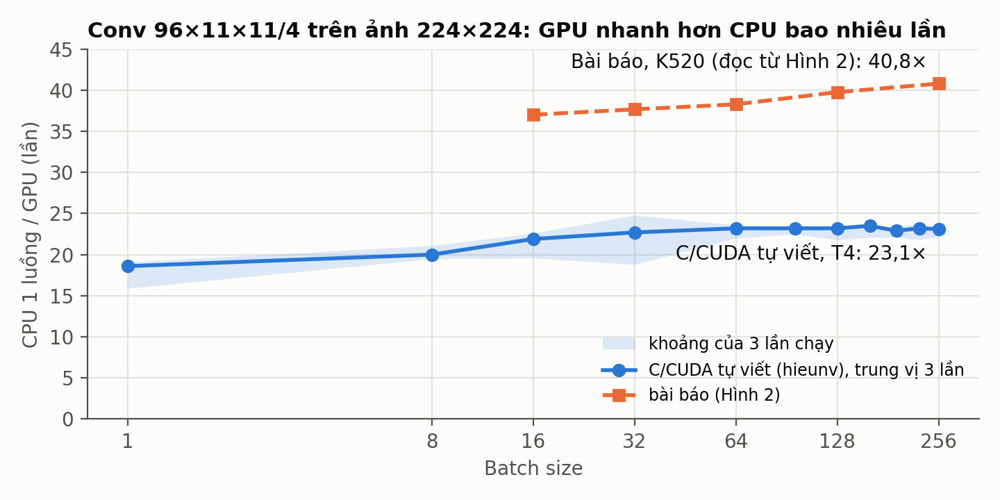
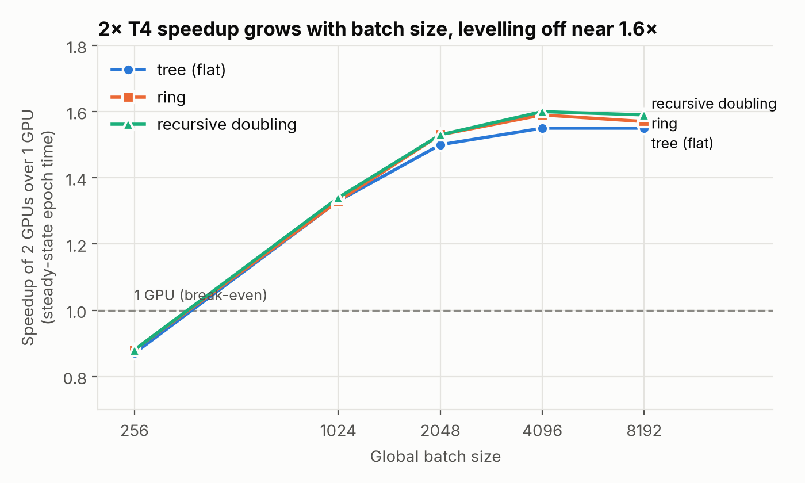
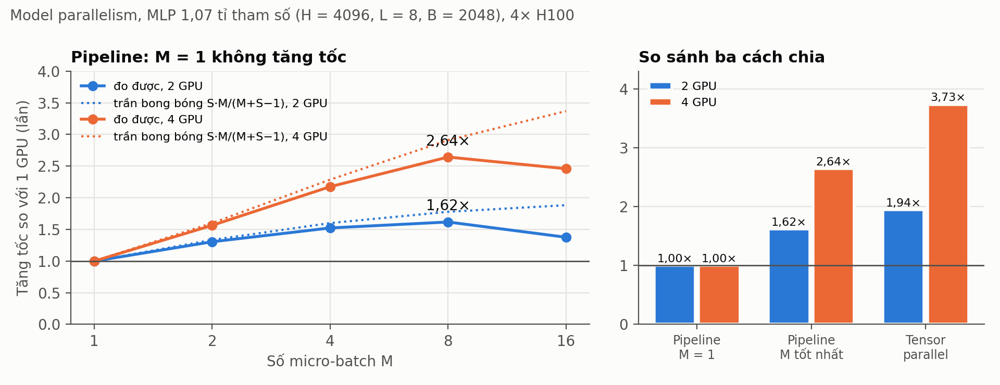

# Huấn luyện học sâu song song và phân tán: kiểm chứng bằng cài đặt tự viết trên MPI và CUDA

**Môn:** Tính toán hiệu năng cao (IT5408), học kỳ 20261B · **Nhóm 10**
**Bài báo tham chiếu:** V. Hegde, S. Usmani, *Parallel and Distributed Deep Learning*, Stanford University, 2016 ([hgpu.org/?p=16046](https://hgpu.org/?p=16046))
**Repo:** `https://gitlab.nqtuan0192.me/vu/hpc_20261b_group10_paralleldistributeddeeplearning_mpi-cuda`

| Thành viên | Thư mục | Phần việc |
|---|---|---|
| Vu Ngoc Vinh | `vinhvn/` | Model parallelism (§2): pipeline và tensor parallelism trên nhiều GPU |
| Nguyen Van Hieu | `hieunv/` | CPU so với GPU (§3): conv theo batch, ma trận–vector theo n, băng thông bộ nhớ |
| Tuan Nguyen | `tuannn/` | CNN với Sync SGD, Parallel SGD, ADMM, Downpour (§5); 6 thuật toán allreduce trên MPI |
| Nguyen Duc Thinh | `thinhnd/` | CNN trên MPI và CUDA: thời gian tới cùng accuracy, ảnh hưởng của gradient trễ (§5.2) |
| Lattana Aphixay | `ltnaphixay/` | SGD song song dữ liệu trên nhiều GPU với allreduce tự viết; chi phí truyền thông (§5) |

---

## Tóm tắt

Bài của Hegde và Usmani nêu ba nhóm nhận định: (i) GPU nhanh hơn CPU khoảng 40 lần ở lớp conv và lớp kết nối đầy đủ, và tỉ lệ này tăng
theo batch và theo kích thước ma trận (§3, đo bằng Caffe); (ii) chi phí truyền thông và độ chính xác của các phương pháp cập nhật
trọng số phân tán Parallel SGD, ADMM và Downpour SGD (§5, chỉ phân tích lý thuyết); (iii) chia mô hình (model parallelism) chỉ nên
dùng khi mô hình không vừa một máy (§2, không đo). Nhóm cài đặt lại từ đầu bằng C, MPI và CUDA, không dùng cuBLAS, cuDNN, NCCL hay
framework học sâu, rồi đo trên sáu cấu hình phần cứng, từ laptop tới 4× H100.

Kết quả chính:

1. **§3 đúng về xu hướng, không đúng về hằng số.** Thời gian conv tuyến tính theo batch (R² ≥ 0,999). Với kernel tự viết, GPU T4 nhanh
   hơn CPU một luồng **23,3×** ở lớp conv của bài và **23,1×** ở phép nhân ma trận–vector n = 16384; trên RTX 4060, với một lớp conv
   nhỏ hơn, tỉ lệ là 40–56× từ batch 64. Tỉ lệ phụ thuộc phần cứng, cách cài đặt và kích thước: ở ma trận nhỏ (n = 256) GPU có thể
   chậm hơn CPU.
2. **Song song dữ liệu trên một máy CPU bão hòa ở khoảng 3,5×** (k = 6–10 tiến trình), do phần tính toán tranh chấp tài nguyên chứ
   không do truyền thông. Parallel SGD cần dữ liệu được trộn: khi dữ liệu không IID độ chính xác rơi từ 98% xuống 77,7%, và ShuffleSGD
   mà bài đề xuất đưa về 97,9%.
3. **Đồng bộ thắng bất đồng bộ khi so ở cùng độ chính xác** (nhanh hơn 1,46–3,31×). Gradient trễ d bước với bước học η càng khó học
   khi tích d·η càng lớn.
4. **Truyền thông quyết định có nên dùng nhiều GPU.** Với mô hình nhỏ ở batch 256, 2 GPU chậm hơn 1 GPU (0,88×) vì khoảng 50% mỗi bước
   là truyền thông; từ batch 1024 trở lên 2 GPU thắng (tới 1,60×). Thuật toán gom về một GPU rồi phát lại (cách bài phân tích) mất băng
   thông khi k tăng (93 → 51 GB/s), còn ring giữ 157 GB/s trên NVLink.
5. **§2 đúng.** Chia mô hình mà không chia micro-batch cho tăng tốc 1,00×. Mô hình 12,9 tỉ tham số không chạy được trên một H100 nhưng
   chạy được trên 2 và 4 GPU. Muốn tăng tốc phải dùng pipeline nhiều micro-batch (2,64× trên 4 GPU) hoặc tensor parallelism (3,73×).

---

## 1. Bài toán

Huấn luyện một mạng nơ-ron là tìm tham số `w ∈ ℝ^p` cực tiểu hóa trung bình hàm mất mát trên `n` mẫu. Mạng sâu có hàng triệu tham số
và cần nhiều dữ liệu, nên một lần huấn luyện trên một nhân CPU có thể mất nhiều ngày. Bài toán của đề tài là **chia việc huấn luyện ra
nhiều đơn vị tính** (nhân CPU, GPU, tiến trình MPI) và đo xem được bao nhiêu, mất gì:

- **Tăng tốc tính toán:** đưa phần nặng nhất (lớp conv và lớp kết nối đầy đủ) lên GPU hoặc chia cho nhiều nhân.
- **Song song dữ liệu:** mỗi đơn vị giữ một bản sao mô hình, xử lý một phần dữ liệu, rồi gộp gradient hoặc tham số. Câu hỏi là gộp
  theo cách nào (đồng bộ hay bất đồng bộ, gộp gradient hay gộp tham số) và chi phí truyền thông là bao nhiêu.
- **Song song mô hình:** chia chính mô hình ra nhiều GPU khi mô hình không vừa bộ nhớ một GPU.

Mỗi thành viên phụ trách một phần của bài báo (bảng ở đầu báo cáo) và có **một bản tuần tự bằng C** và **một bản song song bằng
MPI và/hoặc CUDA** của cùng một bài toán. Bản tuần tự vừa là mốc đo tăng tốc vừa là chuẩn để kiểm tra bản song song tính đúng.

## 2. Mô hình toán

### 2.1 Hàm mất mát và SGD

Với vector điểm lớp `f = f(x_i; w)` của ảnh `x_i` có nhãn `y_i`, mất mát softmax (công thức (2) của bài) và luật cập nhật SGD trên
mini-batch `M`, `|M| = m` (công thức (3)–(4)):

```
L_i(w) = −f_{y_i} + log Σ_j exp(f_j)
w ← w − α · (1/m) Σ_{i∈M} ∇_w L_i(w)
```

Một số phần dùng thêm momentum: `v ← μv + ∇L_M(w)`, `w ← w − αv`.

**Tính tương đương của song song dữ liệu đồng bộ.** Chia `M` thành `k` phần `M_1, …, M_k` có cùng kích thước, mỗi tiến trình `r`
tính `g_r = (1/|M_r|) Σ_{i∈M_r} ∇L_i`. Khi đó `(1/k) Σ_r g_r = ∇L_M`, tức Sync SGD trên `k` tiến trình **bằng đúng** SGD tuần tự với
cùng mini-batch. Sai khác duy nhất là thứ tự cộng số thực. Đây là cơ sở để so bản song song với bản tuần tự đến sai số làm tròn
(mục 3.6).

### 2.2 Lớp conv và lớp kết nối đầy đủ quy về nhân ma trận

Lớp conv đầu của bài: ảnh xám 224×224, 96 bộ lọc 11×11, stride 4, nên đầu ra 54×54. Theo cách Caffe (§3.1 của bài), `im2col` trải
mỗi vùng 11×11 thành một cột, được ma trận `K × P` với `K = 121`, `P = 54·54 = 2916`; conv của một ảnh là phép nhân `(96 × 121)·(121 ×
2916)`, tức `2·96·121·2916 ≈ 67,7` MFLOP. Thời gian cho cả batch `B` là `t(B) = a + b·B`, tuyến tính theo `B` (nhận định §3.2.1).

Lớp kết nối đầy đủ là nhân ma trận–vector `y = Wx` với `W ∈ ℝ^{n×n}`: `2n²` FLOP nhưng phải đọc `4n²` byte, nên cường độ tính toán
chỉ khoảng 0,5 FLOP/byte và thời gian bị giới hạn bởi băng thông bộ nhớ: `t(n) ≈ 4n² / BW`. Tỉ lệ thời gian CPU/GPU vì vậy xấp xỉ tỉ lệ
băng thông bộ nhớ của hai thiết bị.

### 2.3 Mô hình chi phí truyền thông

Gửi một thông điệp `n` byte tốn `α + nβ` (α độ trễ, β = 1/băng thông; bài viết là `L + n/B`). Với `k` tiến trình gộp một vector
`n` byte (allreduce):

| Thuật toán | Thời gian | Ghi chú |
|---|---|---|
| Gom về một máy rồi phát lại (tree, "BitTorrent aggregate" của bài) | `2·log₂k · (α + nβ)` | Bài tính chi phí tổng là `O(L·k) + O(k·p/B)` |
| Driver trung tâm (naive, kiểu parameter server) | `2(k−1) · (α + nβ)` | Driver là nút thắt |
| Recursive doubling | `log₂k · (α + nβ)` | Ít bước, gửi cả vector mỗi bước |
| Ring (reduce-scatter + allgather) | `2(k−1)·α + 2·(k−1)/k · nβ` | Nhiều bước, nhưng băng thông gần tối ưu |

Hai hệ quả kiểm chứng được: với thông điệp nhỏ, số hạng `α` chiếm ưu thế nên thuật toán ít bước (recursive doubling, tree) thắng; với
thông điệp lớn, số hạng `nβ` chiếm ưu thế nên ring thắng, và tree mất băng thông khi `k` tăng.

**Khi nào song song dữ liệu có lợi.** Một bước trên 1 GPU tốn `T_c(B)`, tỉ lệ với batch. Trên `k` GPU tốn `T_c(B)/k + T_ar(p)`, trong
đó `T_ar(p)` là thời gian allreduce gradient `p` tham số, **không phụ thuộc batch**. Tăng tốc `S = T_c(B) / (T_c(B)/k + T_ar(p))` lớn
hơn 1 khi `T_c(B)·(1 − 1/k) > T_ar(p)`, nên mô hình nhỏ cần batch lớn mới có lợi.

### 2.4 Bất đồng bộ và gradient trễ

Trong Downpour SGD (§5.2 của bài), worker tính gradient trên tham số cũ rồi đẩy lên parameter server, nên cập nhật thực tế là
`w_{t+1} = w_t − α ∇L(w_{t−d})` với độ trễ `d`. Bài lập luận: nếu tính một gradient tốn `T` và server áp một cập nhật tốn `τ`, thì
thêm worker quá `T/τ` không còn tăng tốc.

### 2.5 Song song mô hình

**Pipeline** (`S` stage, `M` micro-batch): stage `s` xử lý micro-batch `m+1` trong khi stage `s+1` xử lý `m`. Thời gian lý tưởng là
`(M + S − 1)` khe, so với `S·M` khe nếu chạy lần lượt, nên trần tăng tốc là `S·M/(M + S − 1)` và tỉ lệ bong bóng là
`(S − 1)/(M + S − 1)`. Với `M = 1` trần bằng 1: chia mô hình thuần túy không tăng tốc.

**Tensor parallelism** (kiểu Megatron): khối MLP `X' = X + ReLU(X·W₁)·W₂` với `W₁ ∈ ℝ^{H×F}` chia theo cột, `W₂ ∈ ℝ^{F×H}` chia theo hàng
trên `T` GPU. Mỗi GPU giữ `1/T` trọng số và tính `ReLU(X·W₁⁽ʳ⁾)·W₂⁽ʳ⁾`; tổng các phần là kết quả đúng, nên mỗi khối cần **một allreduce
ở forward và một ở backward**, kích thước `B × H`. Số FLOP mỗi bước là `12·B·H·F·L`.

## 3. Thuật toán và thiết kế song song

### 3.1 Bản tuần tự

| Phần | Chương trình | Mô hình, dữ liệu |
|---|---|---|
| `vinhvn` | `src/mlp_seq.c` | Chồng `L` khối MLP có residual, dữ liệu tổng hợp sinh bằng hàm băm splitmix64 (CPU và GPU sinh ra đúng cùng giá trị) |
| `hieunv` | `c_cuda/bench_seq.c` | Lớp conv của bài (im2col + GEMM chia khối), ma trận–vector, GEMM, đo băng thông |
| `tuannn` | `code/sequential/seq_train.c` | LeNet trên MNIST (61.706 tham số); CNN trên CIFAR-10 |
| `thinhnd` | `cnn/src/seq/train_seq.c` | CNN 54.314 tham số trên Fashion-MNIST |
| `ltnaphixay` | `src/seq/mlp_seq.c` | MLP 784–512–10 (407.050 tham số) trên MNIST |

Mọi bản tuần tự là C một luồng, chỉ dùng thư viện chuẩn, được viết sao cho thứ tự mẫu, khởi tạo và luật cập nhật giống nhánh
tương ứng của bản song song.

### 3.2 Kernel tính toán tự viết

- **GEMM trên CPU** (`hieunv`, `tuannn`): bậc thang tối ưu từ ba vòng lặp `i-j-k` (1,4 GFLOP/s), đổi thứ tự vòng lặp `i-k-j` (13–21),
  tới chia khối theo cache với một ô C giữ trong thanh ghi (28–34 GFLOP/s). Chia khối nhanh hơn bản naive tới 25× ở N = 1024 vì dùng lại
  dữ liệu trong cache, không phải vì ít phép tính hơn.
- **GEMM trên GPU:** đi theo cùng bậc thang naive → tile trong shared memory → chia khối thanh ghi. Bản của `hieunv` (mỗi block một ô
  48 hoặc 64 × 64, mỗi luồng 12–16 tổng trong thanh ghi) đạt trên T4: naive 453 → shared memory 605 → chia khối thanh ghi 1.806
  GFLOP/s. Bản của `vinhvn` (ô 64×64, mỗi luồng 4×4 phần tử, lát K = 16 trong shared memory, ba biến thể A·B, Aᵀ·B, A·Bᵀ từ một template)
  đạt 23,8 TFLOP/s trên H100, khoảng 45% cuBLAS. `ltnaphixay` dùng GEMM tile trong shared memory (`k_matmul_tiled`), chiếm 94,5–95,5%
  thời gian kernel của một bước huấn luyện.
- **im2col** một kernel, mỗi luồng một phần tử; conv Caffe trên GPU là 2 lần khởi chạy kernel mỗi ảnh.
- **Ma trận–vector trên GPU** (`hieunv`): mỗi warp một hàng, đọc `float4` liên tiếp, cộng dồn bằng warp shuffle, để đọc bộ nhớ liền mạch.

### 3.3 Song song dữ liệu bằng MPI

`tuannn` cài bốn phương pháp của §5 trên cùng một mã nguồn. Toàn bộ tham số và gradient nằm trong **một mảng phẳng**, nên đồng bộ
chỉ là một lời gọi allreduce trên một vùng nhớ liên tục.

| Phương pháp | Thuật toán | Truyền thông |
|---|---|---|
| Sync SGD (§5.1) | Mỗi rank tính gradient trên `B/k` mẫu; allreduce, chia `k`, mọi rank cập nhật như nhau | 1 allreduce `p` số mỗi bước |
| Parallel SGD (§5.1.1) | Mỗi rank chạy SGD riêng trên shard của mình; lấy trung bình tham số mỗi `H` bước, mỗi epoch hoặc cuối cùng. **ShuffleSGD:** sau mỗi epoch, all-to-all chuyển `1/k` shard tới từng rank | 1 allreduce mỗi lần lấy trung bình; all-to-all dữ liệu O(D) |
| ADMM (§5.1.2) | Consensus ADMM: `x_i` giải xấp xỉ bằng L bước SGD với hạng phạt `ρ/2‖x − z + u_i‖²`; `z = mean(x_i + u_i)`; `u_i += x_i − z` | 1 allreduce mỗi L bước |
| Downpour (§5.2) | Rank 0 là parameter server; worker đẩy gradient tích lũy mỗi `n_push` bước và lấy tham số mỗi `n_fetch` bước bằng `MPI_Isend/Irecv` không chặn; đo độ trễ (staleness) | điểm–điểm worker ↔ server |

Sáu thuật toán allreduce được viết trên giao tiếp điểm–điểm: ring, recursive doubling, tree (reduce nhị thức + broadcast), naive
(driver trung tâm), cùng `MPI_Reduce + MPI_Bcast` và `MPI_Allreduce` của thư viện để so sánh. Mọi thuật toán tự viết cho kết quả
trùng từng bit trên mọi rank.

`thinhnd` cài ba chế độ trong `train_mpi.c`: **sync** (chia mini-batch, cộng gradient bằng cây nhị thức tự viết, `n/b` vòng mỗi
epoch, mỗi vòng `O(P log p)`), **avg** (mỗi rank chạy SGD trên phần của mình, lấy trung bình tham số cuối epoch) và **async** (rank 0 là
parameter server, worker không chờ nhau). Bản CUDA cho mỗi luồng tính một phần tử đầu ra; gradient của conv tính theo từng map rồi
rút gọn. Để nghiên cứu độ trễ một cách tất định, `train_cuda --delay d` áp gradient tính ở bước `t` vào bước `t + d`.

### 3.4 Song song dữ liệu trên nhiều GPU với allreduce tự viết

`ltnaphixay` chạy SGD đồng bộ trên `k` GPU trong một tiến trình. Mỗi GPU một stream; gradient được lấy trung bình bằng một trong
các thuật toán sau, mỗi thuật toán một tệp trong `src/allreduce/`:

| Phương pháp | Cách hoạt động |
|---|---|
| `host_ref` | Chép mọi gradient về CPU, lấy trung bình, chép ngược lên GPU. Dùng làm chuẩn tính đúng |
| `tree` | Cách của bài: reduce về GPU 0, chia `k`, broadcast lại |
| `ring` | Reduce-scatter rồi allgather: `k − 1` bước, mỗi bước GPU `i` chép một khối `n/k` phần tử sang GPU `i+1` bằng `cudaMemcpyPeerAsync` trên stream của bên nhận, bên nhận cộng bằng kernel; trước mỗi bước chờ cả hai láng giềng bằng event |
| `rd` | Recursive doubling; GPU dư được gộp vào khi `k` không là lũy thừa của 2 |
| `--overlap` | Bắt đầu allreduce gradient lớp 2 trong lúc lan truyền ngược của lớp 1 còn chạy |

Đồng bộ giữa các GPU dùng `cudaEvent` trên stream, không đồng bộ host trong lúc chạy. Biến môi trường `AR_DISABLE_P2P=1` tắt truy
cập trực tiếp giữa GPU, buộc mọi lần chép đi qua bộ nhớ host, để so NVLink với đường đi qua PCIe.

### 3.5 Song song mô hình trên nhiều GPU

`vinhvn` cài hai chế độ trong `src/mlp_cuda.cu`:

- **Pipeline (lịch GPipe).** `L` khối chia thành `S` stage liên tiếp, mỗi stage một GPU; batch chia thành `M` micro-batch. Activation
  ở forward và gradient ở backward chuyển giữa các stage bằng `cudaMemcpyPeerAsync`; phụ thuộc giữa các stage được biểu diễn bằng
  `cudaEventRecord`/`cudaStreamWaitEvent`, nên host không phải chờ trong lúc chạy.
- **Tensor parallelism.** Mỗi khối chia theo chiều `F = 4H` như mục 2.5; all-reduce tự viết bằng recursive doubling (`log₂T` vòng,
  mỗi vòng các cặp GPU trao đổi toàn bộ buffer rồi cộng).

### 3.6 Kiểm tra tính đúng

Mọi phép đo hiệu năng chỉ chạy sau khi bản song song đã khớp bản tuần tự:

| Phần | Kiểm tra | Kết quả |
|---|---|---|
| `vinhvn` | 12 cấu hình (pipeline S = 1, 2, 4 × M = 1, 2, 4, 8; tensor T = 1, 2, 4) so với C tuần tự; C tuần tự so với autograd fp64 | Sai số tương đối của loss ≤ 8·10⁻⁹, của chuẩn gradient ≤ 1,4·10⁻⁸ |
| `hieunv` | Mọi kernel C và CUDA so với tham chiếu float64: ô ở mép tile, K lớn hơn một khối, `im2col` so từng bit, đuôi của phép rút gọn | Chạy trước mỗi lần đo; sai thì chương trình dừng với mã 1 |
| `tuannn` | 13 CTest, gradient so với sai phân hữu hạn, CUDA so với CPU, Sync SGD so với tuần tự | 105 kiểm tra, 0 lỗi; Sync k = 2/4 lệch tuần tự 5,7·10⁻⁸ / 2,9·10⁻⁸ |
| `thinhnd` | Gradient so với sai phân hữu hạn; CUDA so với C | Lệch tối đa 8,9·10⁻⁷; CUDA lệch C 1,8·10⁻⁷ |
| `ltnaphixay` | `simcheck`: 5.670 lần chạy trên CUDA giả lập với thứ tự stream ngẫu nhiên, k = 2..8; 2 GPU so với 1 GPU qua 10 epoch | Các bản sao tham số giống nhau từng bit; loss lệch tối đa 2,3·10⁻⁵ |

## 4. Thực nghiệm

| Phần | Phần cứng | Phần mềm | Lặp lại |
|---|---|---|---|
| `vinhvn` | 4× NVIDIA H100 80GB, một node | CUDA 12.4, FP32 (không Tensor Core) | 1 lần chạy mỗi cấu hình, 3 bước đo sau 1 bước khởi động |
| `hieunv` | Kaggle: Tesla T4 + Xeon 2,0 GHz | gcc 13.3, nvcc 13.0 | 3 lần chạy; GPU 30, CPU 10 lần tính giờ mỗi điểm; thứ tự kích thước xáo trộn |
| `tuannn` | Đợt 1: i5-8257U (4 nhân). Đợt 2: i5-12600K + RTX 2060 | Đợt 2: WSL2, GCC 13.3, OpenMPI 4.1.6, CUDA 12.0 | E4: 3 lần chạy; E5: 2 seed; E1–E3: 3 lần × 5–20 lần đo |
| `thinhnd` | i7-13620H + RTX 4060 Laptop | Windows 11, GCC 16.2, MS-MPI 10.1, CUDA 12.8 | 3–10 lần chạy hoặc seed tùy thí nghiệm |
| `ltnaphixay` | Kaggle 2× T4 (PCIe); RunPod 4× A100 SXM (NVLink) | CUDA 13.0 (T4) | 3 lần chạy mỗi cấu hình, báo trung vị |

Quy trình chung: ghi **dự đoán trước khi chạy** (`PLAN.md`, `PREDICTIONS.md`, `PLAN_C_CUDA.md` của từng phần), lưu log và CSV/JSON gốc
cạnh bảng tổng hợp, ghi điều kiện máy (xung nhịp GPU, power plan) cùng kết quả. Phần cứng khác nhau giữa các phần, nên báo cáo chỉ so
**tỉ lệ** (tăng tốc, xu hướng) giữa các phần, không so thời gian tuyệt đối.

## 5. Kết quả

### 5.1 §3: CPU so với GPU



*Hình 1. Lớp conv đầu của bài. Đường xanh: bản C tuần tự / bản CUDA tự viết (hieunv), Kaggle T4 + Xeon, trung vị 3 lần chạy, vùng
tô là khoảng của 3 lần. Đường cam: điểm đọc từ Hình 2 của bài (Caffe, K520 so với Xeon E5-2670). Vẽ bằng `report/make_figures.py`.*

| Phép đo | Kết quả | Phần cứng | Nguồn |
|---|---|---|---|
| Conv: thời gian theo batch | Tuyến tính, độ dốc 1,46 ms/ảnh (CPU) và 0,0630 ms/ảnh (GPU); R² ≥ 0,999 và ≥ 0,9998 | T4 + Xeon | hieunv |
| Conv: GPU / CPU 1 luồng (bài: khoảng 40×) | **23,3×** (22,3–23,3); 18,6× ở batch 1, phẳng ở khoảng 23× từ batch 64 | T4 + Xeon | hieunv |
| | 40,3× ở batch 64, 56,1× ở batch 1024, 2,95× ở batch 1 (lớp conv 8@5×5 trên ảnh 28×28) | RTX 4060 + i7-13620H | thinhnd T6 |
| | Tham khảo, GPU dùng cuBLAS: 54,5× ở batch 256 (11× nếu tính cả chép dữ liệu) | RTX 2060 + i5-12600K | tuannn E2 |
| Ma trận–vector theo n | O(n²); tăng đều từ **1,6× (n = 256) lên 23,1× (n = 16384)**; đạt 93% (CPU) và 100% (GPU) băng thông đọc đo độc lập | T4 + Xeon | hieunv |
| | GPU **thua** CPU ở n = 256 (0,51×), hòa ở n = 512 (1,10×), thắng 8,37× ở n = 4096 | RTX 4060 | thinhnd T6 |
| Cả mô hình: C tuần tự so với 1 GPU | 33× (CNN), 41× (MLP), 371× (MLP H = 512 trên H100) | RTX 4060; T4; H100 | thinhnd, ltnaphixay, vinhvn |

Nhận xét:

- **Tính tuyến tính theo batch được xác nhận** trên cả CPU và GPU. Tuy vậy, cách gộp cả batch vào một GEMM (không có vòng lặp từng ảnh
  do CPU điều khiển) cũng tuyến tính (R² ≥ 0,998), nên lý do "CPU giữ luồng điều khiển" mà bài đưa ra không suy ra được từ tính tuyến
  tính.
- **Speedup tăng theo batch rồi phẳng.** Từ batch 1 đến 16–32 tỉ lệ tăng rõ (18,6× → 22,7×) vì chi phí khởi chạy kernel được chia cho
  nhiều ảnh; sau đó gần như không đổi. Bài báo cũng chỉ tăng khoảng 10% trong khoảng batch 16–256.
- **Hằng số 40× không lặp lại được, và không phải hằng số.** Trên cùng máy T4, conv C tự viết trên CPU nhanh hơn bản PyTorch (1,46 so
  với 1,88 ms/ảnh), chủ yếu nhờ im2col viết tay (0,13 so với 0,80 ms/ảnh), còn GPU tự viết gần bằng bản PyTorch (86 nghìn so với 95,5 nghìn chu kỳ/ảnh), nên tỉ lệ thấp hơn bản
  PyTorch (23,3× so với 27,8×). Trên RTX 4060 (thinhnd) tỉ lệ lên 40–56×. Nhận định đúng là "GPU nhanh hơn một bậc độ lớn ở lớp conv đủ
  lớn"; con số cụ thể phụ thuộc thiết bị, kích thước lớp và cách cài đặt.
- **Lớp kết nối đầy đủ bị giới hạn bởi băng thông bộ nhớ,** đúng mô hình mục 2.2: matvec đạt 93–100% băng thông đọc đo độc lập, và tỉ lệ
  băng thông GPU/CPU khớp tỉ lệ thời gian. GPU chỉ có lợi khi ma trận đủ lớn và trọng số nằm sẵn trên GPU; với ma trận nhỏ, chi phí
  khởi chạy kernel khiến GPU có thể thua CPU (0,51× ở n = 256 trên RTX 4060). Bản tự viết của hieunv chỉ một lần khởi chạy nên đã nhanh
  hơn CPU từ n = 256.

### 5.2 §5: song song dữ liệu trên CPU bằng MPI


*Hình 2. Strong scaling Sync SGD, LeNet/MNIST, batch tổng 256, i5-12600K (tuannn, đợt 2). Trái: tăng tốc, có và không ghim tiến
trình. Phải: thời gian theo pha; vạch đen là thời gian tính toán lý tưởng T₁/k. Phép đo này dùng `MPI_Allreduce` (xem mục 7).*

| k | Tăng tốc (tuannn, LeNet/MNIST) | Phần tính toán so với lý tưởng | k | Tăng tốc (thinhnd, CNN/Fashion-MNIST) | Chờ + truyền |
|---|---|---|---|---|---|
| 2 | 1,79× | +10% | 2 | 1,88× | 2,2% |
| 4 | 2,91× | +33% | 4 | 3,27× | 13,5% |
| 6 | 3,12× | +67% | 6 | 3,57× | 27,8% |
| 10 | 3,45× | +148% | | | |

- **Tăng tốc bão hòa ở khoảng 3,5×** trên một máy 6 nhân hiệu năng cao. Ở phần của tuannn, giới hạn **không phải truyền thông**:
  allreduce chỉ tốn 0,04–0,20 s mỗi epoch, còn phần forward + backward chậm hơn lý tưởng tới 148% ở k = 10 vì các tiến trình tranh băng
  thông bộ nhớ, bộ đệm L3 và xung nhịp chung. Với mô hình nhỏ hơn và batch chia nhỏ hơn (thinhnd), phần chờ và truyền tăng tới 27,8%
  ở 6 rank.
- **Độ chính xác không đổi khi tăng k** (98,9% ở k = 1; 98,9% và 98,8% ở k = 4 và 8 sau 10 epoch), đúng tính tương đương ở mục 2.1.


*Hình 3. Độ chính xác test sau 10 epoch, 4 và 8 tiến trình, dữ liệu IID (xanh) và shard sắp theo nhãn, tức không IID (cam);
trung bình 2 seed (tuannn, đợt 2).*

| Phương pháp (k = 4) | IID | Không IID | Tăng tốc | Byte gửi mỗi rank |
|---|---|---|---|---|
| Tuần tự | 98,9% | – | 1,00× | 0 |
| Sync SGD | 98,9% | – | 3,14× | 1,73 GB |
| Parallel SGD, trung bình mỗi epoch | 99,0% | **94,6%** (k = 8: 88,4%) | 3,58× | 3,7 MB |
| Parallel SGD + ShuffleSGD | 99,1% | **99,0%** | 3,58× | 83 MB |
| Parallel SGD, trung bình mỗi 10 bước | 98,9% | 98,6% | 3,37× | 174 MB |
| ADMM | 99,1% | 96,9% (k = 8: 87,4%) | 3,33× | 89 MB |
| Downpour (đẩy gradient mỗi bước) | 98,9% | 97,3% | 2,48× | 1,71 GB |

- **Parallel SGD cần dữ liệu đại diện ở mỗi máy,** như giả thiết của bài: khi shard sắp theo nhãn, lấy trung bình mỗi epoch rơi còn
  94,6% (k = 4) và 88,4% (k = 8) sau 10 epoch, và còn 77,7% sau 3 epoch ở đợt 1. **ShuffleSGD** mà bài đề xuất đưa về 99,0%. Lấy trung
  bình thường xuyên hơn (mỗi 10 bước) cũng gỡ được mà không phải di chuyển dữ liệu.
- **ADMM** tốt hơn Parallel SGD mỗi epoch khi dữ liệu không IID (88,5% so với 77,7% ở đợt 1), nhưng xấu đi khi k tăng và kém ShuffleSGD.
- **Downpour chậm nhất** (2,48× ở k = 4) và tốn 34% thời gian cho truyền thông ở k = 8: server là nút thắt, đúng như bài cảnh báo.

**So ở cùng độ chính xác (thinhnd, T8).** So số epoch hoặc tốc độ mỗi epoch dễ gây hiểu lầm, nên thinhnd đo thời gian tới cùng ngưỡng
validation 85%, 5 seed, learning rate chọn riêng cho từng biến thể và không nằm ở mép lưới:

| Phương pháp (6 rank) | Momentum | Epoch cần | Thời gian tới 85% | Tăng tốc tới ngưỡng | Tăng tốc mỗi epoch |
|---|---|---|---|---|---|
| C tuần tự | 0,9 | 3 | 7,74 s | 1,00× | 1,00× |
| CUDA (1 GPU) | 0,9 | 3 | 0,24 s | **32,9×** | 35,8× |
| MPI đồng bộ | 0,9 | 5 | 2,73 s | 2,84× | 3,89× |
| MPI đồng bộ | 0 | 9 | 5,15 s | 1,50× | 3,88× |
| MPI bất đồng bộ | 0,9 | 16 | 9,08 s | 0,85× | 4,42× |
| MPI bất đồng bộ | 0 | 14 | 7,38 s | 1,05× | 4,50× |
| MPI trung bình tham số | 0,9 | 8 | 4,09 s | 1,89× | 5,04× |

**Đồng bộ nhanh hơn bất đồng bộ** 1,46× (không momentum) và 3,31× (momentum 0,9), ở 5/5 seed. Bất đồng bộ và trung bình tham số nhanh
hơn mỗi epoch nhưng cần nhiều epoch hơn, nên tới ngưỡng chậm hơn. Momentum giúp bản đồng bộ gấp 2 lần nhưng không giúp bản bất đồng bộ.

**Gradient trễ (thinhnd, T4).** Mô phỏng tất định gradient trễ `d` bước, momentum 0, 15 epoch, 10 seed, với bước hiệu dụng η:

| d | η | d·η | Seed học được (validation > 70%) |
|---|---|---|---|
| 15 | 0,005 | 0,075 | 10/10 |
| 15 | 0,01 | 0,15 | 10/10 |
| 15 | 0,02 | 0,30 | 9/10 |
| 3 | 0,10 | 0,30 | 7/10 |
| 11 | 0,05 | 0,55 | 4/10 |
| 3 | 0,20 | 0,60 | 0/10 |
| 15 | 0,05 | 0,75 | 1/10 |

Tích `d·η` càng lớn thì càng dễ không học được, nhưng không có ngưỡng sắc (hai ô cùng tích 0,30 cho 9/10 và 7/10). Độ trễ lớn
(d = 15) vẫn học được nếu bước nhỏ và đủ epoch. Đây là cơ chế khiến bất đồng bộ cần nhiều epoch hơn ở bảng T8.

### 5.3 §5: chi phí truyền thông trên nhiều GPU



*Hình 4. Tăng tốc của 2× T4 so với 1 T4 theo batch toàn cục, MLP 407.050 tham số (gradient 1,63 MB), ba thuật toán allreduce tự viết
(ltnaphixay). Nhãn trong hình bằng tiếng Anh.*

| Cấu hình (2× T4, batch 256) | Epoch ổn định | Tăng tốc | Truyền thông không che được |
|---|---|---|---|
| 1 GPU | 0,199 s | 1,00× | 0,5% |
| host_ref (qua CPU) | 0,420 s | 0,47× | 74,9% |
| tree | 0,225 s | 0,88× | 50,9% |
| ring | 0,225 s | 0,88× | 49,8% |
| rd | 0,228 s | 0,87× | 50,1% |

- **Ở batch 256, 2 GPU chậm hơn 1 GPU.** Một lần allreduce 1,63 MB tốn khoảng 0,36–0,39 ms trên GPU (1,19 ms qua CPU), gần bằng phần
  tính toán tiết kiệm được khi chia batch. Đúng điều kiện ở mục 2.3: `T_ar` không đổi theo batch, nên batch lớn hơn mới có lợi. Điểm hòa
  vốn nằm giữa batch 256 và 1024; ở batch 4096 đạt 1,60×.
- **Thuật toán nào nhanh nhất phụ thuộc kích thước thông điệp,** đúng mô hình α–β: ≤ 8 KB thì chép qua host nhanh nhất (độ trễ thấp);
  16 KB–2 MB thì recursive doubling (ít bước); ≥ 4 MB thì ring (băng thông tốt nhất).


*Hình 5. Băng thông bus của allreduce theo kích thước thông điệp trên 4× A100 SXM, NVLink so với đi qua bộ nhớ host (ltnaphixay).*

| Thông điệp 256 MB, băng thông bus | tree | ring | rd |
|---|---|---|---|
| k = 2, NVLink | 93 GB/s | 154 GB/s | 124 GB/s |
| k = 4, NVLink | 51 GB/s | **157 GB/s** | 101 GB/s |
| k = 4, qua host | 4,0 GB/s | 5,8 GB/s | 4,0 GB/s |

- **Tree mất băng thông khi k tăng** (93 → 51 GB/s) vì GPU 0 phải nhận và gửi mọi thông điệp; đây là đúng cách gom-rồi-phát mà bài phân
  tích, và nó không phải lựa chọn tốt khi gradient lớn. Ring giữ 154–157 GB/s.
- **Số hạng độ trễ phụ thuộc k thấy được rõ:** với thông điệp tới 2 MB ở k = 4, ring tốn khoảng 0,44 ms vì cần 2(k−1) = 6 bước đồng bộ,
  còn rd chỉ khoảng 0,15 ms với log₂k = 2 bước. Đây là số hạng `O(L·k)` trong công thức của bài.
- **NVLink nhanh hơn đi qua host 12–27 lần** với thông điệp lớn. Ở batch 4096, 4 GPU đạt 1,59× với NVLink nhưng chỉ 1,23–1,33× khi qua
  host. Ở batch 256, thêm GPU vẫn chậm hơn kể cả với NVLink: GPU càng nhanh thì truyền thông càng đắt về tương đối.

Phần MPI trên CPU (tuannn E3, k = 2–10, 16 MiB) cho cùng kết luận: ring nhanh nhất từ k = 4, nhanh hơn cả `MPI_Allreduce` của
OpenMPI ở k = 10 (33 ms so với 47 ms); naive (driver trung tâm) tăng gần tuyến tính theo k.

### 5.4 §2: song song mô hình



*Hình 6. MLP 1,07 tỉ tham số (H = 4096, L = 8, B = 2048) trên 4× H100, mốc 1 GPU 553 ms/bước. Trái: tăng tốc của pipeline theo số
micro-batch, đường chấm là trần bong bóng `S·M/(M+S−1)`. Phải: so ba cách chia (vinhvn). Vẽ bằng `report/make_figures.py`.*

| Chế độ | GPU | M | Bước (ms) | Tăng tốc | Trần pipeline | Bộ nhớ mỗi GPU | Dữ liệu chuyển mỗi bước |
|---|---|---|---|---|---|---|---|
| 1 GPU | 1 | – | 553 | 1,00× | – | 10,7 GB | 0 |
| pipeline | 4 | 1 | 554 | **1,00×** | 1,00× | 3,3 GB | 201 MB |
| pipeline | 4 | 8 | 209 | 2,64× | 2,91× | 3,1 GB | 201 MB |
| pipeline | 4 | 16 | 225 | 2,46× | 3,37× | 3,1 GB | 201 MB |
| tensor | 2 | – | 285 | 1,94× | – | 5,9 GB | 1.074 MB |
| tensor | 4 | – | 148 | **3,73×** | – | 3,4 GB | 4.295 MB |

| Mô hình 12,9 tỉ tham số (H = 8192, L = 24; trọng số + gradient ≈ 103 GB) | Kết quả | Bước | Bộ nhớ đỉnh mỗi GPU |
|---|---|---|---|
| 1 GPU | **hết bộ nhớ khi cấp phát** | – | – |
| 2 GPU, pipeline | chạy được | 793 ms | 52,6 GB |
| 4 GPU, pipeline | chạy được | 549 ms | 26,6 GB |

- **Nhận định §2 của bài được xác nhận:** chia mô hình thuần túy (M = 1) cho đúng 1,00× vì các GPU chạy lần lượt; lợi ích duy nhất là bộ
  nhớ mỗi GPU giảm gần 1/số GPU, và nhờ đó mô hình 103 GB chạy được trên 2 hoặc 4 GPU.
- **Muốn tăng tốc phải có thêm song song bên trong:** pipeline với 8 micro-batch đạt 2,64× trên 4 GPU, sát trần lý thuyết 2,91×; M = 16 lại
  chậm hơn vì micro-batch nhỏ làm GEMM kém hiệu quả. Tensor parallelism đạt 3,73× (hiệu suất 93%) dù mỗi bước có 16 all-reduce và
  chuyển nhiều dữ liệu hơn pipeline 20 lần, vì với H = 4096 phần tính toán chiếm phần lớn thời gian và NVLink đủ nhanh.

## 6. Thảo luận: đối chiếu với bài báo

| Nhận định của bài | Kết quả của nhóm | Đánh giá |
|---|---|---|
| §2: model parallelism chỉ dùng khi mô hình không vừa một máy | M = 1 cho 1,00×; mô hình 103 GB chỉ chạy được trên ≥ 2 GPU | **Xác nhận** |
| §3: thời gian conv tuyến tính theo batch, O(n) | R² ≥ 0,999 trên CPU và GPU (T4 + Xeon); R² ≥ 0,998 trên i5-8257U, i5-12600K, RTX 2060 | **Xác nhận** |
| §3: GPU nhanh hơn CPU khoảng 40× | 23× (T4, kernel tự viết), 40–56× (RTX 4060, lớp nhỏ hơn), < 1× với ma trận nhỏ | **Đúng bậc độ lớn, không phải hằng số** |
| §3: batch lớn hơn cho speedup cao hơn | Tăng tới batch 16–32 rồi phẳng | **Một phần** |
| §3: FC là O(n²), speedup tăng theo n | Số mũ 2,0–2,2; speedup tăng đều theo n; bị giới hạn bởi băng thông bộ nhớ | **Xác nhận**, kèm giải thích bằng băng thông |
| §5: allreduce gom-rồi-phát, chi phí `O(L·k) + O(k·p/B)` | Đo được cả hai số hạng; nhưng ring tốt hơn tree với gradient lớn, tree mất băng thông khi k tăng | **Đúng về dạng; thuật toán của bài không tối ưu** |
| §5.1.1: Parallel SGD cần trộn dữ liệu; ShuffleSGD khắc phục | 77,7% → 97,9% (đợt 1); 94,6% → 99,0% (đợt 2) | **Xác nhận**; lấy trung bình thường xuyên cũng khắc phục được |
| §5.1.2: ADMM tránh được việc trộn dữ liệu | Tốt hơn Parallel SGD mỗi epoch nhưng kém ShuffleSGD, xấu đi khi k tăng | **Một phần** |
| §5.2: bất đồng bộ bỏ chờ để tăng tốc | Nhanh hơn mỗi epoch, nhưng tới cùng độ chính xác chậm hơn đồng bộ 1,46–3,31×; Downpour bị server giới hạn | **Không đúng khi so ở cùng độ chính xác** |
| §5.2: Downpour không tăng tốc khi số worker vượt `T/τ` | Chưa đo | Chưa kiểm chứng |

Bài báo đo §3 bằng Caffe trên một máy năm 2016 và chỉ phân tích §5 bằng O(·). Kiểm chứng bằng số đo cho thấy hai điều bài chưa nêu:
(i) **truyền thông có thể lớn hơn phần tính toán tiết kiệm được** khi mô hình nhỏ hoặc GPU nhanh, nên có trường hợp thêm GPU làm chậm đi;
(ii) **chọn thuật toán gộp theo kích thước thông điệp** quan trọng hơn chọn số máy: thông điệp nhỏ cần ít bước, thông điệp lớn cần
dùng hết băng thông.

## 7. Giới hạn

- **Một máy cho mỗi phép đo.** MPI chạy trên một node qua shared memory, đa GPU nằm trong một máy. Chưa đo qua mạng giữa nhiều máy,
  nên "băng thông" trong mô hình α–β ở phần MPI thực chất là băng thông bộ nhớ.
- **Mô hình nhỏ** ở các phần song song dữ liệu (LeNet 61.706 tham số, CNN 54.314 tham số, MLP 407.050 tham số): truyền thông tương đối
  rẻ, kết luận về tỉ lệ truyền thông có thể khác với mô hình lớn.
- **Số lần lặp ít:** 1 lần chạy mỗi cấu hình ở phần model parallelism, 2–5 seed ở các thí nghiệm độ chính xác. Chênh lệch vài phần trăm
  chưa đủ để kết luận.
- **Phần còn dùng thư viện:** phép đo strong scaling (Hình 2) của tuannn dùng `MPI_Allreduce`; các thuật toán allreduce tự viết được
  đo riêng ở E3. Trung bình tham số khi đánh giá Parallel SGD cũng gọi `MPI_Allreduce`. Mã của tuannn có lựa chọn cuBLAS để so sánh;
  các con số GPU trong báo cáo này lấy từ kernel tự viết. Bản PyTorch trong `hieunv/code/` và `vinhvn/reference_pytorch/` chỉ là mốc
  tham khảo.
- **Môi trường không đồng nhất:** phần của tuannn đợt 2 chạy trên WSL2 nên không ghim được P-core/E-core; phần của thinhnd chỉ build
  trên Windows; T4 trên Kaggle bị giới hạn công suất 70 W nên xung nhịp dao động (đã ghi lại cùng kết quả).
- **Siêu tham số** chọn một lần cho phần lớn thí nghiệm (trừ T8 của thinhnd), nên so sánh độ chính xác giữa các phương pháp là so cấu
  hình hợp lý, không phải tốt nhất của mỗi phương pháp.

## 8. Kết luận

Nhóm đã cài đặt lại từ đầu bằng C, MPI và CUDA các thành phần mà bài báo mô tả: kernel conv và nhân ma trận, bốn phương pháp tối ưu
phân tán, sáu thuật toán allreduce trên CPU và ba thuật toán trên GPU, pipeline và tensor parallelism. Mỗi bản song song được chứng
minh tính đúng so với bản tuần tự trước khi đo. Các nhận định định tính của bài phần lớn đúng (conv tuyến tính theo batch, FC O(n²),
Parallel SGD cần trộn dữ liệu, model parallelism chỉ để vừa bộ nhớ). Các nhận định định lượng thì không cố định: tỉ lệ GPU/CPU từ dưới
1× tới 56×, và lợi ích của nhiều GPU phụ thuộc tỉ lệ giữa truyền thông và tính toán mỗi bước.

Hướng tiếp theo:

1. Chạy song song dữ liệu qua mạng giữa nhiều máy để thấy số hạng độ trễ mạng thật trong `O(L·k)`.
2. Đo điểm bão hòa `T/τ` của Downpour SGD với nhiều worker hơn.
3. Chạy lại strong scaling của tuannn bằng ring allreduce tự viết thay cho `MPI_Allreduce`.
4. Kết hợp song song dữ liệu với pipeline hoặc tensor parallelism trên mô hình lớn hơn, nơi truyền thông và bộ nhớ cùng là giới hạn.

## Phụ lục A. Biên dịch và chạy

Lệnh biên dịch và chạy bản tuần tự và bản song song của từng phần nằm ở [`README.md`](../README.md) mục 3 ở gốc repo, và chi tiết hơn
trong `README.md` của từng thư mục. Hình 1 và Hình 6 vẽ lại bằng `python3 report/make_figures.py` (cần matplotlib); các hình còn lại
lấy từ thư mục của thành viên.

## Phụ lục B. Nguồn số liệu

| Mục | Dữ liệu gốc |
|---|---|
| 5.1 | `hieunv/results/kaggle/c_cuda{1,2,3}_20261125_050209/`, `hieunv/results/analysis/c_cuda_tables.md`; `thinhnd/results/t6_layers.md` |
| 5.2 | `tuannn/experiments/results/SUMMARY_dot1.md`, `SUMMARY_dot2.md` và thư mục `dot2_e4_*`, `dot2_e5_*`; `thinhnd/results/t4*.md`, `t7_scaling.md`, `t8_fair_comparison.md` |
| 5.3 | `ltnaphixay/runs/kaggle-final-2026-11-22/`, `kaggle-sweep-2026-11-23/`, `runpod-a100-2026-11-23/`; `tuannn/experiments/results/dot2_e3_comm/` |
| 5.4 | `vinhvn/results/bench.csv`, `bench.log`, `check.log` |

## Tài liệu tham khảo

1. V. Hegde, S. Usmani. *Parallel and Distributed Deep Learning*. Stanford University, 2016.
2. M. Zinkevich, M. Weimer, A. Smola, L. Li. *Parallelized Stochastic Gradient Descent*. NIPS, 2010.
3. S. Boyd, N. Parikh, E. Chu, B. Peleato, J. Eckstein. *Distributed Optimization and Statistical Learning via the Alternating
   Direction Method of Multipliers*. Foundations and Trends in Machine Learning, 2011.
4. J. Dean et al. *Large Scale Distributed Deep Networks*. NIPS, 2012.
5. Y. Jia et al. *Caffe: Convolutional Architecture for Fast Feature Embedding*. ACM Multimedia, 2014.
6. R. Thakur, R. Rabenseifner, W. Gropp. *Optimization of Collective Communication Operations in MPICH*. IJHPCA, 2005.
7. Y. Huang et al. *GPipe: Efficient Training of Giant Neural Networks using Pipeline Parallelism*. NeurIPS, 2019.
8. M. Shoeybi et al. *Megatron-LM: Training Multi-Billion Parameter Language Models Using Model Parallelism*. arXiv:1909.08053, 2019.
